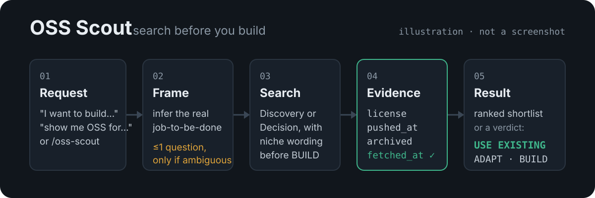
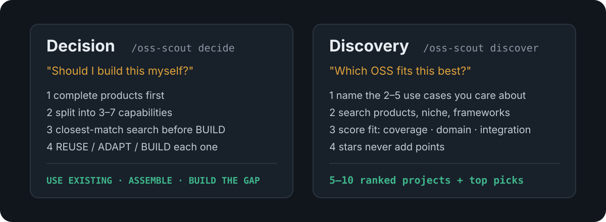
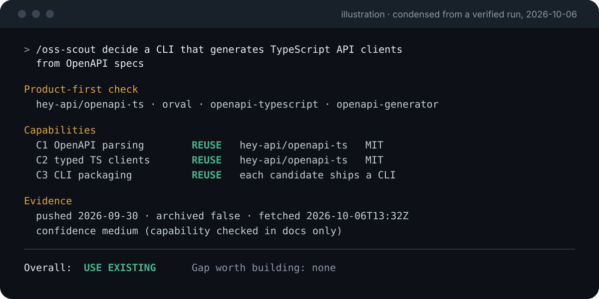

# OSS Scout

**Search before you build.** OSS Scout is an agent Skill for Claude Code and Codex. It finds the open-source projects, products and Skills that already do what you need, and tells you whether to use one, adapt one, or build. Every license and activity fact is fetched by a script, never filled in from model memory.

<p align="center">
  
</p>

- **Discovery**: "which OSS fits this best?" You get a short ranked list of projects to try or learn from.
- **Decision**: "should I build this myself?" You get REUSE / ADAPT / BUILD per capability. **USE EXISTING** ("don't build, use X") is a normal, good outcome.
- **Evidence, not memory**: license, last push, archived state and fetch time come from `scripts/evidence.py`. Anything it can't verify is shown as `unknown`.

v1.0.0 is released. Complete instructions are in **[docs/USAGE.md](docs/USAGE.md)**.

## Quick Start

```bash
git clone https://github.com/MUNEZU/oss-scout-public.git
cd oss-scout-public
python3 scripts/install.py      # links the Skill into Claude Code and Codex
```

Then ask your agent:

| Harness | Discovery | Decision |
|---|---|---|
| Claude Code | `/oss-scout discover <goal>` | `/oss-scout decide <goal>` |
| Codex | `$oss-scout discover <goal>` | `$oss-scout decide <goal>` |

Plain language works too. "Show me good open-source projects for…" starts Discovery; "I want to build…" or "should we build this ourselves?" starts Decision.

## Which mode should I use?

<p align="center">
  
</p>

| You want to… | Use | You get |
|---|---|---|
| Browse, compare or learn from projects | **Discovery** | 5–10 projects ranked by Match Score, top picks, what each one does not cover |
| Decide before writing code | **Decision** | REUSE / ADAPT / BUILD per capability, an overall verdict, and the gap worth building |
| Both | Ask for both | Discovery first, then Decision reusing its evidence |

## Example prompts

**Discovery: observing AI coding agents**

```text
/oss-scout discover tools to observe what my AI coding agents changed: which worktrees and branches exist, what each one committed, and whether the work was merged. Read-only is fine.
```

**Decision: build or reuse?**

```text
/oss-scout decide a CLI that generates TypeScript API clients from OpenAPI specs
```

**An ambiguous request**

```text
What Git management and visualization tools do you recommend?
```

"Git tools" could mean a daily Git client, a history viewer, or a way to watch AI agents' worktrees. OSS Scout asks **one** short question with 2–3 options before ranking anything. Clear requests get no question.

## What a result looks like

<p align="center">
  
</p>

The image above is an illustration, condensed from a verified run on 2026-10-06. It is not a screenshot. Real output also lists the search queries used and any unknowns.

## How to read the result

- **Match Score (Discovery)**: fit to *your* goal, 0–100. It adds capability coverage (0–50), domain fit (0–30) and integration fit (0–20). Stars and popularity never add points, so a small exact-fit project can outrank a famous generic one.
- **Confidence**: how solid the evidence is (`high` / `medium` / `low`). It is separate from fit. Scores below `high` confidence are shown as `~78` rather than `78`; the `~` means "estimate", not a penalty.
- **Evidence and license flags**: license and gate (`ok`, `review`, `blocked-for-target`), last push, archived state, and fetch time. Copyleft, source-available, unknown and archived projects are flagged and never shown as a clean top pick.
- **Verdicts (Decision)**:
  - **REUSE**: use as-is.
  - **ADAPT**: wrap, configure, fork or combine.
  - **BUILD**: allowed only after a targeted closest-match search, which is listed in the result.
  - **Overall**: **USE EXISTING**, **ASSEMBLE** or **BUILD THE GAP**.

More detail, prompt patterns and troubleshooting: [docs/USAGE.md](docs/USAGE.md).

## Install

Run the installer from the main checkout, not from a temporary worktree:

```bash
python3 scripts/install.py --dry-run    # show the plan
python3 scripts/install.py              # Claude Code + Codex
python3 scripts/install.py --target codex --codex-skills-dir ~/.codex/skills
```

- It creates the symlinks `~/.claude/skills/oss-scout` and `~/.agents/skills/oss-scout`, which point to this repository, so pulling updates takes effect immediately.
- An existing file, directory or symlink elsewhere is reported as a conflict and left untouched (exit code 3). A run that finds the correct link reports `already_installed`.
- It refuses to link a source with no `SKILL.md`, or one that is a linked git worktree (use `--allow-worktree` to override).
- It does not touch any harness settings, hooks or other skills.

OSS Scout is a companion to the [search-first](https://github.com/affaan-m/ECC/tree/main/skills/search-first) workflow and does not replace it. Installing search-first alongside it is recommended but optional. OSS Scout adds a product-first check, a closest-match pass before any BUILD, and the evidence gate.

## Evidence script

```bash
python3 scripts/evidence.py langfuse/langfuse https://github.com/Arize-ai/phoenix --target hosted
python3 scripts/evidence.py --package npm:express
python3 scripts/evidence.py --help
```

- **Data sources:** the GitHub REST API (unauthenticated, about 60 requests per hour) and OSV.dev. No keys are read or stored.
- **Output:** JSON (`oss-scout/evidence/1`), with per-item `status`, `facts`, `flags`, `sources` (URL + fetch time) and `errors`.
- **Undetected licenses:** when GitHub cannot detect a license (`NOASSERTION`), the script pattern-matches the license file and marks the result `license_needs_human_review`.
- **Failures:** rate limits, network failures and missing data are reported as errors. They are never filled in.
- **License gate:** `--target` (`personal`, `oss`, `commercial`, `hosted`) decides whether a license is `ok`, `review` or `blocked-for-target`. This is a flag, not legal advice.

## Layout

| Path | Purpose |
|---|---|
| `SKILL.md` | Mode selection, both workflows, stop conditions, output contracts |
| `references/evidence-rules.md` | Required facts, license handling, what must not be inferred |
| `references/discovery-rules.md` | Match Score, gates, shortlist rules for Discovery mode |
| `references/miss-analysis.md` | Five-class diagnosis when a recommendation is shown to be wrong |
| `scripts/install.py` | Symlink installer for Claude Code and Codex |
| `scripts/evidence.py` | Deterministic evidence fetcher (Python 3.10+, standard library only) |
| `docs/USAGE.md` | User guide |

## Non-goals

OSS Scout does not include any of the following:

- scheduled trending or radar feeds;
- star-history tracking;
- persistent catalogs;
- scheduling, storage or databases;
- crawlers;
- a web UI;
- a custom tool server;
- full supply-chain scanning;
- legal advice.
